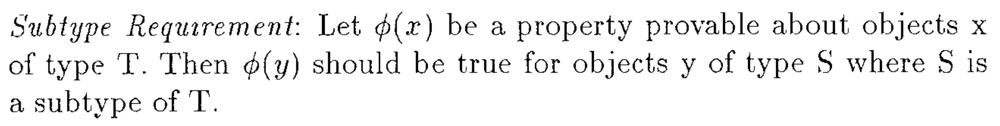
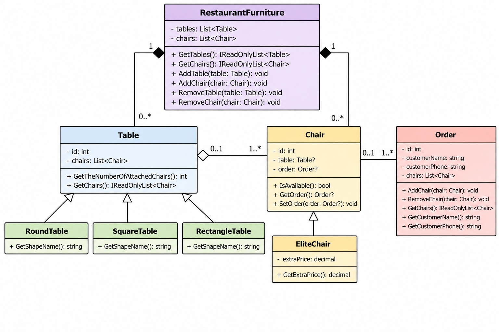
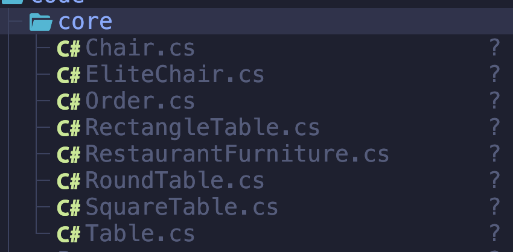

# Restaurant Ordering System

## Introduction

The project showcases how SOLID principles are applied in modern
software development. A Restaurant Ordering System was chosen as
the domain model to demonstrate these concepts.

## Defining the problem

The Restaurant has some finite number of tables. Each table has a
finite number of chairs. On some chairs it is allowed to sit to
anybody, while on others not, because they are ordered via our system.

## Defining Use Cases

So, the 'user' of restaurant can firstly to 'communicate' with this
restaurant: to come, to seat, to buy, to leave, etc. But they will
not be allowed to seat on the ordered chairs. So, we need to
design use cases for this ordering system, not for the restaurant
itself.

Firstly, before user can order something, he wants to see what is
already ordered. After that, we will tell us his credentials. He
will not be able to see who exactly ordered which place, but Admin
could do this.

So, use cases are:
User:

  1. View available places for ordering.
  2. Order available place. (by telling his name and phone number)
  3. Cancel the order.

Admin (everything that user can):

  1. Look who ordered which place.

## Small assumptions

As it is small project, the authentication system is not done,
it is out of scope. We just assume that Administrator has
his own password that he created before. For now the password
for admin is 'admin'.

## Why OOP?

So, we need to create ordering system of chairs. We might manage
them as a sequence of bits, where 0 is unordered and 1 is ordered.
The group of 5 bits will represent chairs near one table. This
could work good if the chairs would be welded together and the
tables to be built directly into the structural load-bearing walls.
Why only in that scenario? Imagine how the restaurant buys new table,
moves chairs so that now one table has more chairs than another. The
logic representation of bits even if still will work will require too
much cognitive loading for humans, and they will rather use notepad
instead of our application. That is why we need OOP, code need to be
consistent with real world.

## Design the classes

### SRP

We are working with chairs and with tables. So, normally we can do:

```C#
public class Chair {
  private boolean isOrdered;
  private String orderedByName;
  private String orderedByPhone;
  
  public orrderChair(){

  }

  public cancelOrder(){

  }

}
```

In this implementation, Chair class has more than one responsibility.
By ordering, it needs also to get information from user what is his name
and phone number. And after a registration will be done, we could not by
one command change for example the name who ordered this chair, in case
when user will want to change nickname. That is why we need the thing
called SRP. Single Responsability Principle says that one thing needs
to have only one reason to change. So, we need to split this class into
several classes, with only one responsability each.

```C#
public class Chair {

}

public class ChairOrder {

}

public class Table {

}
// ...
```

That is much better. Now we have Chair class that is responsible only
for chairs, to order the chair we have another class.

### OCP

We have the class `Chair`. And, let's imagine we already write
some code there and the project works and all good, but then
happens something surprisingly unexpected! The restaurant changes its
politics and makes some chairs for elite with extra price and others
remain just simple chairs. We might do something like this:

```C#
public class Chair {
  public boolean is_elite; // if false then is not, if trut then should pay more

}
```

If we do like this, we face several problems. Code becomes messy, if
restaurant will add new type of chair we will need again to edit the whole class.
That comes up to bring more interactions with class, more theoretically made mistakes
and, obvious, bugs. That is why we have OCP principle. Every class should be open for
extensions but closed for modifications. So, instead of having one class, we `extend`
this class by creating new class that is child for that one. So, we will have something like this:

```C#
public class Chair {

}

public class EliteChair : Chair { // extended functionality, that may have new functions

}

// ...
```

### LSP

Now, let's imagine that restaurant has different type of Tables: round table, square
table, long rectangle table, etc. For instance:

```C#
public class Table {
  // ...
}

public class RounTable : Table {

}

public class SquareTable : Table {
  // ...
}

public OCPlass RectangleTable : Table {
  // ...
}

// ...
```

And then we will have some function that works with objects of class Table.
So, let the function be `getTheNumberOfAttachedChairs()`. It will receive
as a parameter the object of type table and will return the amount of chairs
it has attached.

```C#

public int getTheNumberOfAttachedChairs(Table table) {
  return table.getTheNumberOfAttachedChairs();
}

```

That function should work not only with objects from Table class, but also with
objects from its child classes, i.e with RounTable, SquareTable, RectangleTable, etc.
That is why we have Barbara Liskov Substitution Principle.
It says that if class B is a child of class A, then we should be able to use objects
of class B instead of objects of class A without breaking the code.

Funny that so simple rule has so complex mathematical explanation.


*Figure 1. Liskov Substitution Principle [1].*

### Finally design the classes



So, we will make the order of a chair, not of a group of chairs or of a table.
That we will do alter if business (restaurant) will require. That is one of
advantages to use SOLID. If some new requirements come up, it will be easy
to implement without recoding the whole project.

The RestaurantFurniture class will aggregate all the instances in one place,
so that we will not loose the objects somewhere in the Heap.

## Those classes are the core of our app



After that the core is implemented, it is time to implement the basic user
interaction with those things. There are many ways to do this, from just
separatoin UI from infrastructure till Onion and Clean architecture. But this
is out of the scope in this lab, so, we will just create a simple loop in
Program.cs file with use cases.

```C#
while(work) {
   DisplayMenu();
   int c = Console.RaedLine();
   switch(c){
   case 0: ...; break;
   case 1: ...; break;
     ...
   } default {
   Console.WriteLine("Choosed incorrect option");
   }

}
```

In those use cases should be options:

1) Load, Save the Restaurant object.
2) Add, Remove the table or a chair.
3) View all the data about some specific table or chair.
4) View the list of all tables or chairs.
5) Same as 3 and 4 but for Orders.

Of course, right now we don't have the separation of roles of users, we even don't have the
User class in the model, therefore, user has now access to all use cases. To add
functionality to distinguish User from Admin is too long, so, we will just add
the word `(user)` to the start at every user use case in menu. For this demo, if
you want that user can do, then, just imagine that you can press only on those
use cases with `(user)` label.

## References

1. B. H. Liskov and J. M. Wing, “A Behavioral Notion of Subtyping,”
   *ACM Transactions on Programming Languages and Systems*, vol. 16, no. 6,
   pp. 1811–1841, Nov. 1994.
   [PDF](https://www.cs.cmu.edu/~wing/publications/LiskovWing94.pdf)
