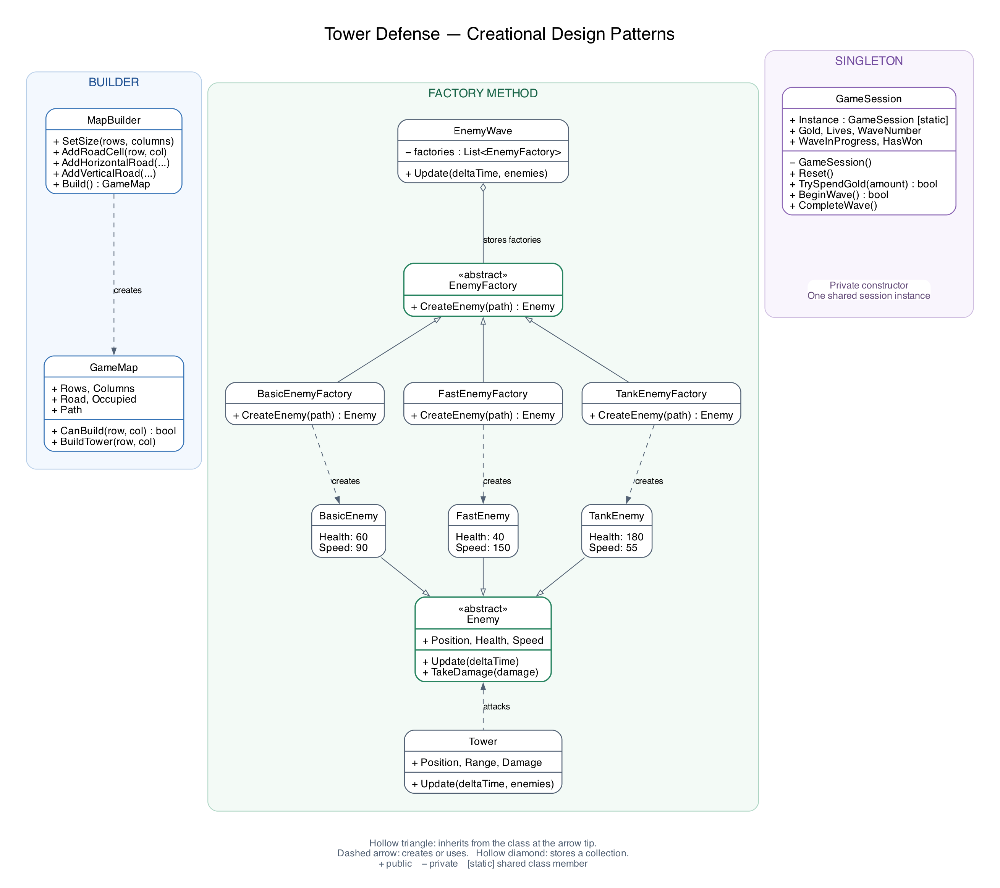

# Tower Defense

## Introduction

The project shows how Creational Design Patterns can be applied in a
small game. A Tower Defense game was chosen as the domain model to
demonstrate three patterns: Builder, Factory Method and Singleton.

The game is written in C#. For opening a window, drawing the map and
reading keyboard and mouse input, Raylib-cs is used [2].

## Defining the problem

The player has a base that needs to be protected. Enemies enter the map,
follow a predefined road and try to reach that base. The player can build
towers near the road, and those towers attack enemies within their range.

Of course, we cannot allow the player to place a tower directly on the
road. Otherwise, instead of protecting the base, the player could just
close the entrance and go drink some tea. In this game, towers do not
change the route. They can only be placed on free cells outside the road.

The player also has a finite amount of gold and lives. Building a tower
costs gold, destroying an enemy gives some gold back, and an enemy that
reaches the base takes one life. So, the player needs to decide where to
build towers and when to start the next wave.

## Defining Use Cases

Firstly, before the enemies appear, the player needs to see the map and
place some towers. After that, the player starts a wave and watches how
the defence works. If there is enough gold, more towers can be built,
including while the wave is running.

So, the use cases are:

1. View the map, available gold and remaining lives.
2. Build a tower on a free cell outside the road.
3. View the attack range of a tower.
4. Start the next wave of enemies.
5. Pause and continue the game.
6. Restart the game after winning, losing or just making a bad decision.

The towers choose their targets automatically. The player does not need
to click every enemy separately.

## Small assumptions

As it is a small project, there is one map, one type of tower and three
types of enemies. There are five waves. The player starts with 180 gold
and 10 lives, and each tower costs 60 gold.

A normal enemy has 60 health, a fast enemy has 40, and a tank enemy has
180. The fast enemy moves faster, while the tank moves slower. So,
different enemies are not just the same circle painted with another color.

When an enemy reaches the base, the player loses one life, regardless of
the enemy type. Completing a wave gives another 30 gold. To win, the
player needs to finish all five waves with at least one life remaining.

There is no saving, tower upgrading or map editor in this version.
The tower applies damage immediately, and a short blue line shows the
shot. There is no separate flying projectile object.

## Why Creational Design Patterns?

So, we already have classes for maps, towers and enemies. We might just
write `new` everywhere and create whatever object is needed at that moment.
For a very small program, that could work.

But imagine that we want another road, another enemy type, or accidentally
create two separate objects that both claim to store the current amount
of gold. The problem is not that C# cannot create those objects. The
problem is deciding how they should be created and which parts of the
program should know about it.

That is where creational patterns are useful [1]. In this project, the
map is built step by step, enemies are created through factory methods,
and the current game session has one shared instance.

## Design the classes

### Builder

We are working with a map made of cells. It has rows and columns, some
cells contain the road, and some can be occupied by towers.

We could create a road matrix manually, mark every road cell and then
pass it to the map constructor. This would work, but imagine writing
all those assignments for a road that turns several times. It becomes
difficult to see where the road actually goes.

That is why we use Builder. Instead of describing the whole map in one
large constructor call, we describe it in several understandable steps.

```csharp
GameMap map = new MapBuilder()
    .SetSize(8, 12)
    .AddHorizontalRoad(2, 0, 4)
    .AddVerticalRoad(4, 2, 5)
    .AddHorizontalRoad(5, 4, 11)
    .Build();
```

Now we can read the code almost like instructions: set the size, add a
horizontal road, turn down, add another horizontal road, and build the map.

`MapBuilder` stores the settings until `Build()` is called. Its methods
return the same builder, which allows us to write the calls as a chain.
For example:

```csharp
public MapBuilder AddRoadCell(int row, int col)
{
    path.Add((row, col));
    return this;
}
```

The builder checks that the size is configured and that road cells are
inside the map. After that, it creates the `GameMap` object.

There are two representations of the road. `Road` is a matrix that tells
us whether a cell belongs to the road. `Path` is a sequence that tells
enemies in which order to visit those cells. A matrix alone cannot tell
an enemy which direction to take at a turn.

Two connected road segments can contain the same endpoint. The builder
keeps that cell once when it appears twice in a row. However, visiting
the same cell again later is not removed from the route.

`Occupied` stores the cells where towers have been built. The map checks
construction with the existing method:

```csharp
public bool CanBuild(int row, int col)
{
    return row >= 0 && row < Rows
        && col >= 0 && col < Columns
        && !Road[row, col]
        && !Occupied[row, col];
}
```

So, the builder is responsible for creating the map, while the finished
map is responsible for answering questions about its cells.

### Factory Method

Now, let's imagine that every enemy is created directly inside the game
loop. A normal enemy appears, so we write `new BasicEnemy(...)`. Later,
a fast enemy appears, so we add another condition and another constructor.
Then a tank enemy is added, and the same thing happens again.

Conditions themselves are not a problem. But we do not need the game loop
to know how every concrete enemy is constructed. It should be able to
work with the common `Enemy` type.

That is why we introduce a base factory with a method for creating an enemy:

```csharp
public abstract class EnemyFactory
{
    public abstract Enemy CreateEnemy(IReadOnlyList<Vector2> path);
}
```

Concrete factories decide which enemy to return. For example:

```csharp
public sealed class FastEnemyFactory : EnemyFactory
{
    public override Enemy CreateEnemy(IReadOnlyList<Vector2> path)
    {
        return new FastEnemy(path);
    }
}
```

There are also `BasicEnemyFactory` and `TankEnemyFactory`. Each one creates
its corresponding enemy. All three factories can be used through the
base type `EnemyFactory`.

The `EnemyWave` class prepares a list of factories for the current wave.
When it is time to create another enemy, it does this:

```csharp
EnemyFactory factory = factories[nextEnemy];
enemies.Add(factory.CreateEnemy(path));
nextEnemy++;
```

The variable is declared as `EnemyFactory`, but its actual object can be
a basic, fast or tank factory. Its overridden method creates the required
concrete enemy. That is the Factory Method used in this project.

To add another enemy type, we would add its class and factory, then include
that factory in the wave composition. The common movement and tower
attack code would still work with `Enemy`.

The choice of which factory to put into a wave is still made with ordinary
conditions. Factory Method does not make that choice disappear; it gives
us a common method for creating the selected product.

### Singleton

We also need to store gold, lives and the current wave number. We might
create a `GameSession` object whenever some part of the program needs
this information.

But imagine that one object says the player has 180 gold, while another
says there is no gold left. Both calculations could be correct for their
own objects, but they would describe two different games.

For this project, there is only one active game session. So, we use
Singleton to provide one shared instance:

```csharp
public sealed class GameSession
{
    public static GameSession Instance { get; } = new GameSession();

    private GameSession()
    {
        Reset();
    }

    // Other properties and methods are omitted here.
}
```

The constructor is private, which means that code outside this class
cannot call `new GameSession()`. Instead, the game loop gets the object
through `GameSession.Instance`.

This object stores the amount of gold, remaining lives, number of defeated
enemies and progress of the waves. Its properties have private setters,
so changes are made through methods such as `TrySpendGold`, `LoseLife`
and `CompleteWave`.

For example, `TrySpendGold` checks whether a purchase is allowed before
subtracting gold. The player cannot build a tower first and only later
discover that there was not enough money to pay for it.

When the player restarts, `Reset()` restores the initial values in the
same instance. It does not create another session object.

Of course, Singleton is not a solution for every game. If we needed
several independent game sessions at the same time, one shared object
would become a limitation. Here we have one local game, so this restriction
matches the current project.

### Finally design the classes

The main relationships are shown below. The diagram leaves out most
properties so that the creation of objects is easier to see.



*Figure 1. Main classes and the three creational design patterns.*

So, we have one builder for the map, three factories for three enemy types,
and one shared session for the current game. `EnemyWave` manages enemy
creation over time, while `Tower` handles target selection and attacks.

## Those classes are the core of our game

After the core is implemented, it is time to connect it to user input and
put something on the screen. There are many ways to organize a game,
but for this laboratory a simple loop in `Program.cs` is enough.

The structure of the loop is the following. This is a simplified outline;
the actual input, update and drawing code is written inside the loop.

```csharp
while (!Raylib.WindowShouldClose())
{
    // Read input: build towers, start a wave, pause or restart.

    // Update enemies, towers and the current game session.

    Raylib.BeginDrawing();
    Raylib.ClearBackground(Color.DarkGray);

    // Draw the map, towers, enemies and interface.

    Raylib.EndDrawing();
}
```

The enemy speed is measured in pixels per second, so movement uses
`Speed * deltaTime`. This gives the distance that an enemy can travel
during the current frame. If it reaches a waypoint, any remaining distance
is used to continue towards the next one, including around a corner.

A tower searches for the nearest living enemy inside its range. After a
shot, it waits for its attack interval before shooting again. Destroyed
enemies are removed and give a reward. Enemies that reach the end of the
road are also removed, but they take a life instead.

One detail is that all enemies being spawned does not mean that the wave
has ended. Some of them can still be walking along the road. The wave
finishes only when all planned enemies have appeared and the list of
active enemies is empty.

The player uses the left mouse button to build towers, Space to start a
wave, P to pause and R to restart. Hovering over a tower shows its range.
After a victory or defeat, the game displays the result and allows a restart.

## References

1. E. Gamma, R. Helm, R. Johnson and J. Vlissides,
   *Design Patterns: Elements of Reusable Object-Oriented Software*.
   Addison-Wesley, 1994.
   [Publisher's page](https://www.informit.com/store/design-patterns-elements-of-reusable-object-oriented-9780201633610).
2. Raylib-cs contributors, *C# bindings for raylib*.
   [Project repository](https://github.com/raylib-cs/raylib-cs).
