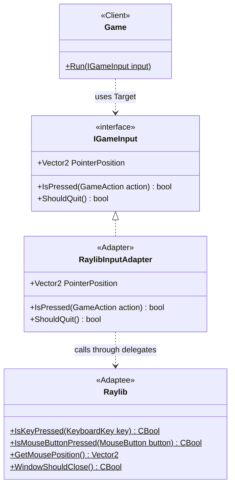
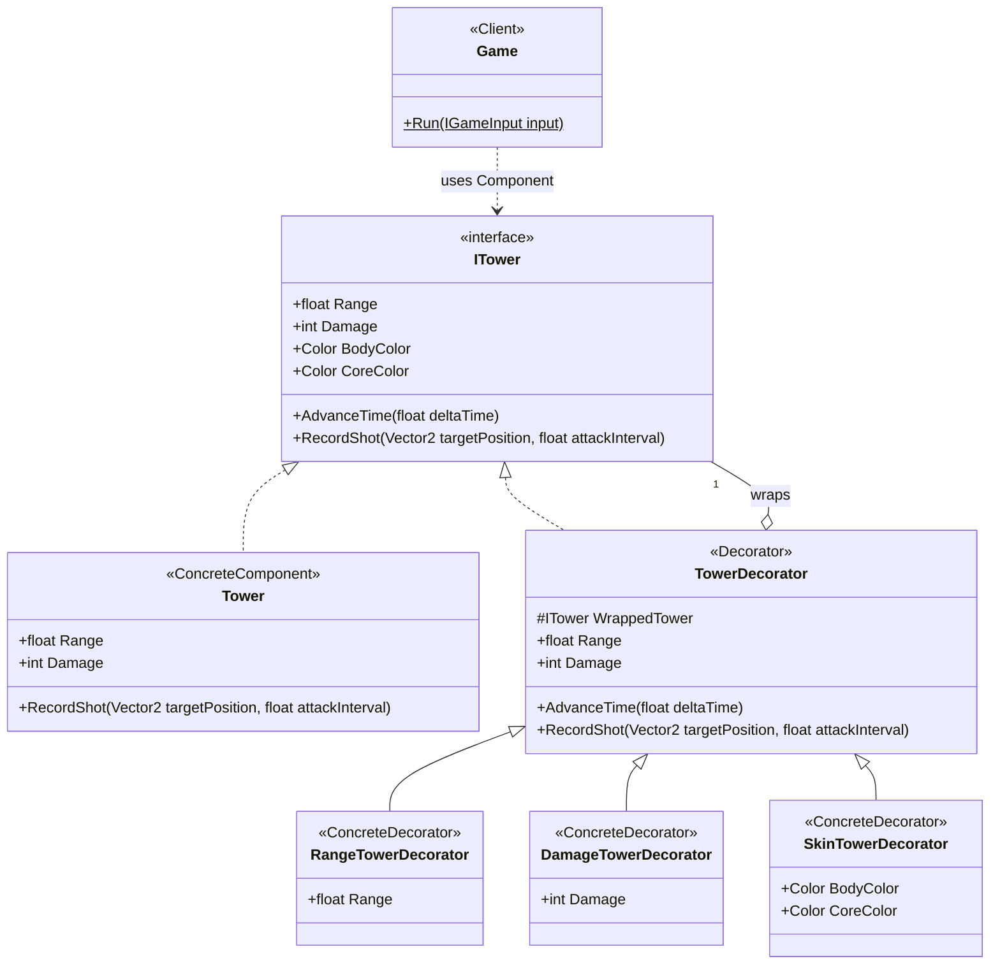
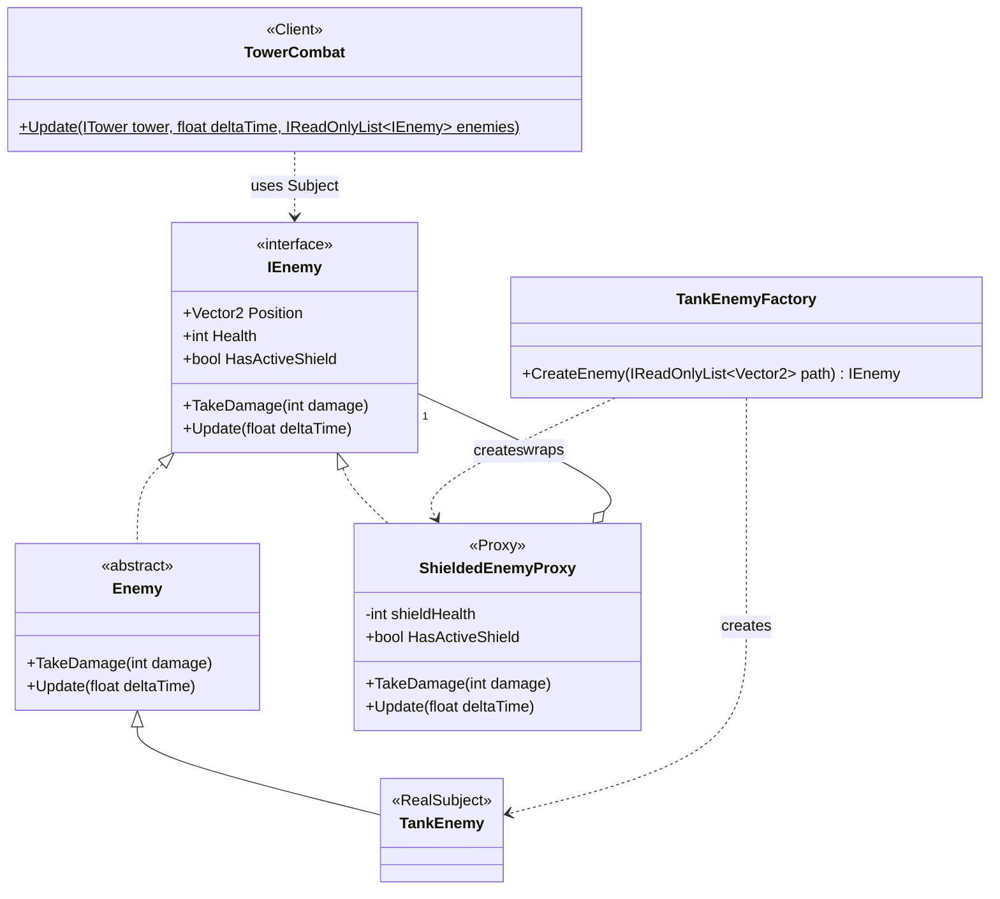

# Tower Defense

## Introduction

Laboratory Work No. 2 explores structural design patterns in the C# Tower Defense game from Lab 1. The player spends gold to place and upgrade towers beside a road, and the towers automatically attack enemies before they reach the base. The aim is to survive five waves. This lab uses Adapter for input, Decorator for tower upgrades, and Proxy for tank shields.

## Design the classes

### Adapter

The game needs to ask whether the player wants to start a wave, build a tower, or buy an upgrade. Raylib-cs reports keyboard keys, mouse buttons, the cursor position, and window state. `RaylibInputAdapter` translates between those interfaces. The adaptee is the third-party `Raylib_cs.Raylib` API from the project's Raylib-cs dependency.

#### Class diagram



#### Code snippet

```csharp
public Vector2 PointerPosition => getMousePosition();

public bool IsPressed(GameAction action)
{
    return action switch
    {
        GameAction.Restart => isKeyPressed(KeyboardKey.R),
        GameAction.TogglePause => isKeyPressed(KeyboardKey.P),
        GameAction.StartWave => isKeyPressed(KeyboardKey.Space),
        GameAction.BuildTower => isMouseButtonPressed(MouseButton.Left),
        GameAction.BuyRangeUpgrade => isKeyPressed(KeyboardKey.One),
        GameAction.BuyDamageUpgrade => isKeyPressed(KeyboardKey.Two),
        GameAction.BuySkinUpgrade => isKeyPressed(KeyboardKey.Three),
        _ => throw new ArgumentOutOfRangeException(nameof(action), action, null),
    };
}

public bool ShouldQuit() => windowShouldClose();
```

`Game.Run` asks `IGameInput` about a `GameAction`, such as `StartWave`. The adapter selects the corresponding Raylib operation, for example an edge-triggered check of `KeyboardKey.Space`, and returns the result to the game. [RaylibInputAdapter.cs](../code/TowerDefense/Input/RaylibInputAdapter.cs#L36) · [Game.cs](../code/TowerDefense/Game.cs#L12) · [TowerDefense.csproj](../code/TowerDefense/TowerDefense.csproj#L10)

#### Unit tests

- `KeyboardActionQueriesTheMappedRaylibKey` covers all six keyboard actions and checks both the exact key passed to the input function and the Boolean returned to the game.
- `BuildActionQueriesTheLeftMouseButton` checks that `BuildTower` queries the left mouse button once and forwards its pressed or released state.
- `PointerAndQuitReflectTheCurrentRaylibValues` changes the simulated pointer position and exit flag between calls and checks that both queries return the current values.

The tests instantiate the real adapter with supplied input functions. Those functions record the arguments or return simulated input so the tests can run without opening a Raylib window. [RaylibInputAdapterTests.cs](../code/TowerDefense.Checks/RaylibInputAdapterTests.cs)

```text
  Passed TowerDefense.Checks.RaylibInputAdapterTests.PointerAndQuitReflectTheCurrentRaylibValues [3 ms]
  Passed TowerDefense.Checks.RaylibInputAdapterTests.KeyboardActionQueriesTheMappedRaylibKey(action: Restart, expectedKey: R, pressed: True) [2 ms]
  Passed TowerDefense.Checks.RaylibInputAdapterTests.KeyboardActionQueriesTheMappedRaylibKey(action: BuyRangeUpgrade, expectedKey: One, pressed: False) [< 1 ms]
  Passed TowerDefense.Checks.RaylibInputAdapterTests.KeyboardActionQueriesTheMappedRaylibKey(action: TogglePause, expectedKey: P, pressed: False) [< 1 ms]
  Passed TowerDefense.Checks.RaylibInputAdapterTests.KeyboardActionQueriesTheMappedRaylibKey(action: BuyDamageUpgrade, expectedKey: Two, pressed: True) [< 1 ms]
  Passed TowerDefense.Checks.RaylibInputAdapterTests.KeyboardActionQueriesTheMappedRaylibKey(action: BuySkinUpgrade, expectedKey: Three, pressed: False) [< 1 ms]
  Passed TowerDefense.Checks.RaylibInputAdapterTests.KeyboardActionQueriesTheMappedRaylibKey(action: StartWave, expectedKey: Space, pressed: True) [< 1 ms]
  Passed TowerDefense.Checks.RaylibInputAdapterTests.BuildActionQueriesTheLeftMouseButton(pressed: False) [1 ms]
  Passed TowerDefense.Checks.RaylibInputAdapterTests.BuildActionQueriesTheLeftMouseButton(pressed: True) [< 1 ms]
```

### Decorator

A player can buy several upgrades for a tower that is already on the map. Each upgrade wraps the tower currently stored in the game, so an upgrade can wrap a plain `Tower` or another decorator. The same tower keeps its position, cooldown, and last shot throughout the purchases.

#### Class diagram



#### Code snippet

```csharp
// TowerDecorator.cs (excerpt)
protected ITower WrappedTower { get; }

public Vector2 Position => WrappedTower.Position;
public virtual float Range => WrappedTower.Range;
public virtual int Damage => WrappedTower.Damage;
public float AttackInterval => WrappedTower.AttackInterval;
public virtual Color BodyColor => WrappedTower.BodyColor;
public virtual Color CoreColor => WrappedTower.CoreColor;
public virtual TowerUpgrade Upgrades => WrappedTower.Upgrades;
public bool CanShoot => WrappedTower.CanShoot;
public bool IsShooting => WrappedTower.IsShooting;
public Vector2 LastTargetPosition => WrappedTower.LastTargetPosition;

public void AdvanceTime(float deltaTime) => WrappedTower.AdvanceTime(deltaTime);

public void RecordShot(Vector2 targetPosition, float attackInterval)
    => WrappedTower.RecordShot(targetPosition, attackInterval);

// RangeTowerDecorator.cs
public sealed class RangeTowerDecorator(ITower tower) : TowerDecorator(tower)
{
    public override float Range => base.Range + 55;
    public override TowerUpgrade Upgrades => base.Upgrades | TowerUpgrade.Range;
}
```

The base decorator forwards queries and shot state to the wrapped `ITower`. `RangeTowerDecorator` adds 55 to the range that it receives, while the damage and skin decorators override their own properties, so the three effects can accumulate. [TowerDecorator.cs](../code/TowerDefense/Towers/TowerDecorator.cs#L13) · [RangeTowerDecorator.cs](../code/TowerDefense/Towers/RangeTowerDecorator.cs#L3) · [DamageTowerDecorator.cs](../code/TowerDefense/Towers/DamageTowerDecorator.cs#L3) · [SkinTowerDecorator.cs](../code/TowerDefense/Towers/SkinTowerDecorator.cs#L5)

#### Unit tests

- `AllUpgradeOrdersProduceTheSameTower` tests all six orders for stacking the three decorators and checks the resulting range of 210, damage of 40, and maroon and gold colors. It also checks position, attack interval, and installed upgrades.
- `UpgradedTowerHitsOneTargetBeyondItsOriginalRange` puts two enemies outside the base range of 155. The upgraded tower reaches them and deals 40 damage to the nearer enemy only.
- `SkinChangesColorsWithoutChangingCombatStats` checks that both colors change while range, damage, and attack interval stay the same.

[TowerDecoratorTests.cs](../code/TowerDefense.Checks/TowerDecoratorTests.cs)

```text
  Passed TowerDefense.Checks.TowerDecoratorTests.SkinChangesColorsWithoutChangingCombatStats [4 ms]
  Passed TowerDefense.Checks.TowerDecoratorTests.UpgradedTowerHitsOneTargetBeyondItsOriginalRange [< 1 ms]
  Passed TowerDefense.Checks.TowerDecoratorTests.AllUpgradeOrdersProduceTheSameTower(first: Damage, second: Range, third: Skin) [1 ms]
  Passed TowerDefense.Checks.TowerDecoratorTests.AllUpgradeOrdersProduceTheSameTower(first: Damage, second: Skin, third: Range) [< 1 ms]
  Passed TowerDefense.Checks.TowerDecoratorTests.AllUpgradeOrdersProduceTheSameTower(first: Range, second: Skin, third: Damage) [< 1 ms]
  Passed TowerDefense.Checks.TowerDecoratorTests.AllUpgradeOrdersProduceTheSameTower(first: Skin, second: Damage, third: Range) [< 1 ms]
  Passed TowerDefense.Checks.TowerDecoratorTests.AllUpgradeOrdersProduceTheSameTower(first: Skin, second: Range, third: Damage) [< 1 ms]
  Passed TowerDefense.Checks.TowerDecoratorTests.AllUpgradeOrdersProduceTheSameTower(first: Range, second: Damage, third: Skin) [< 1 ms]
```

### Proxy

A tank spawns with 180 health and a separate shield with 500 HP. `ShieldedEnemyProxy` wraps the tank and applies the shield rules at `TakeDamage`. While the shield is active, each hit subtracts its full value from the shield and forwards one tenth of the damage to the tank using integer division. The hit that breaks the shield still receives the reduction. The next hit is forwarded in full.

#### Class diagram



#### Code snippet

```csharp
public void TakeDamage(int damage)
{
    if (!HasActiveShield || damage <= 0)
    {
        enemy.TakeDamage(damage);
        return;
    }

    shieldHealth = Math.Max(0, shieldHealth - damage);
    enemy.TakeDamage(damage / ShieldDamageDivisor);
}

public void Update(float deltaTime) => enemy.Update(deltaTime);
```

The proxy checks the shield before subtracting damage, which keeps the breaking hit in the reduced-damage branch. It forwards movement to the wrapped enemy, so shield lifetime depends on hits. [ShieldedEnemyProxy.cs](../code/TowerDefense/Enemies/ShieldedEnemyProxy.cs#L30) · [TankEnemyFactory.cs](../code/TowerDefense/Factories/TankEnemyFactory.cs#L8)

#### Unit tests

- `ActiveShieldForwardsOneTenthOfTheDamageEvenAfterTimePasses` updates the tank for five seconds, checks that the proxy still exposes its movement, and verifies that a hit of 100 takes 10 HP from the wrapped tank.
- `ShieldBreaksAfterFiveHundredDamageAndSubsequentHitsPassThrough` checks that the shield survives 499 damage, breaks after one more point, and then passes the next hit of 25 through unchanged.
- `TheHitThatExceedsRemainingShieldHealthIsStillReduced` checks that a 100-point hit against the last 50 shield HP breaks the shield and deals 10 damage to the tank.

[ShieldedEnemyProxyTests.cs](../code/TowerDefense.Checks/ShieldedEnemyProxyTests.cs)

```text
  Passed TowerDefense.Checks.ShieldedEnemyProxyTests.TheHitThatExceedsRemainingShieldHealthIsStillReduced [3 ms]
  Passed TowerDefense.Checks.ShieldedEnemyProxyTests.ShieldBreaksAfterFiveHundredDamageAndSubsequentHitsPassThrough [< 1 ms]
  Passed TowerDefense.Checks.ShieldedEnemyProxyTests.ActiveShieldForwardsOneTenthOfTheDamageEvenAfterTimePasses [< 1 ms]
```

## How the patterns work together

1. The player hovers over a tower and presses `2`. `RaylibInputAdapter` reports `GameAction.BuyDamageUpgrade` through `IGameInput`.
2. The corresponding `TowerUpgradeOffer` checks the purchase and applies `DamageTowerDecorator` to the existing `ITower`. The game stores the returned `ITower` in the same slot.
3. During a combat update, `TowerCombat.Update` reads target range and damage through `ITower`. If the nearest target in range is a shielded tank, `target.TakeDamage(tower.Damage)` reaches `ShieldedEnemyProxy` through `IEnemy`. A 40-point shot removes 40 shield HP and 4 tank HP while the shield is active.

The combat call in step 3 exercises Decorator and Proxy in one path. The purchase path in steps 1 and 2 exercises Adapter and Decorator. The game loop uses `IGameInput`, `ITower`, and `IEnemy` throughout those paths. [Game.cs](../code/TowerDefense/Game.cs#L79) · [TowerShop.cs](../code/TowerDefense/Towers/TowerShop.cs) · [TowerCombat.cs](../code/TowerDefense/Towers/TowerCombat.cs#L8)

## Reuse from Lab 1 and project structure

`MapBuilder` still builds the road, and the `GameSession` singleton still holds gold, lives, and wave state. Factory Method creates the enemies used in combat. `EnemyWave` works with `EnemyFactory`, and `TankEnemyFactory` constructs a `TankEnemy`, wraps it with `ShieldedEnemyProxy`, and returns the result as `IEnemy`. [Game.cs](../code/TowerDefense/Game.cs#L20) · [EnemyWave.cs](../code/TowerDefense/Enemies/EnemyWave.cs#L33) · [TankEnemyFactory.cs](../code/TowerDefense/Factories/TankEnemyFactory.cs#L6)

The folder layout follows those responsibilities. `Input` contains the adapter and its target interface. `Enemies` and `Towers` contain the domain types and their wrappers. `Factories` handles enemy construction. `Program.cs` wires up the input implementation, `Game.cs` runs the game, and `TowerDefense.Checks` contains the tests.

## Running the demo and tests

Run these commands from `lab_02` with the .NET 10 SDK.

```bash
dotnet run --project code/TowerDefense
dotnet test lab_02.sln --logger "console;verbosity=normal"
```

1. Left-click a free cell beside the road to build a tower. Hover over the tower to see its range and upgrade offers.
2. Press `1` to add range for 30 gold, `2` to add single-target damage for 40 gold, and `3` to buy the cosmetic skin for 15 gold. The offer changes to `owned`, the range circle grows, and the tower takes on maroon and gold colors.
3. Press `Space` to start each wave. Tanks appear starting in wave 3. A blue ring shows an active shield, and disappears when nearby towers deal enough damage to break it. Continue shooting to see subsequent hits take full health damage.

Gameplay feedback currently appears in the Raylib window. The console output below comes from the test runner.

The excerpts above come from one xUnit run, which reported the following totals.

```text
Test Run Successful.
Total tests: 20
     Passed: 20
```

## Conclusions

The hardest part was making purchases affect real shots while preserving the original tower's cooldown and shot state. The wrappers forward that state, and the combat loop reads effective range and damage through `ITower`. The shield also needed an explicit rule for the hit that exhausts it, which is now covered by a unit test.

If I were redesigning the shield display, I would show the shield's remaining HP alongside the tank's health bar. The player could then see how much damage is needed to break the shield.
